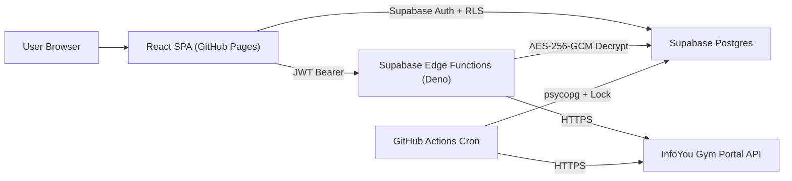

# gym-bot

Automated multi-user gym class booking platform for the InfoYou TeamSystem portal (`inforyou.teamsystem.com`), combining a React SPA, Supabase (Postgres + Auth + Edge Functions), and a scheduled Python booking runner.

## Architecture



### Components

- **Frontend (`web/`)**: React 18 + Tailwind CSS SPA for sign-in, weekly lesson slot preferences, interactive calendar view, and manual booking/cancellation. Deployed to GitHub Pages via `.github/workflows/pages.yml`.
- **Edge Functions (`supabase/functions/`)**: Deno serverless endpoints that validate Supabase JWTs via `auth.getUser()`, decrypt stored gym credentials, and proxy requests to the gym portal.
- **Database (`supabase/migrations/`)**: Postgres schema with Row Level Security (RLS) on `public.users`, `public.preferences`, and `public.booking_daily_lock`, plus the atomic `acquire_booking_lock` PL/pgSQL function.
- **Booking Automation (`scripts/book_all_users.py`, `src/gym_bot/`, `api/`, `utils/`)**: Scheduled Python job (`.github/workflows/book.yml`) running every 30 minutes in the morning window (`04:00-07:30 UTC`, gated to `>= 07:00 Europe/Rome`) with per-user daily distributed locking and automatic retries on failure.

## Quick Start (Local Development)

Prerequisites: **Python 3.11+**, **Node.js 18+**, **Docker Desktop**, and **Supabase CLI**.

```powershell
# 1. Python environment
python -m venv .venv
.\.venv\Scripts\Activate.ps1
pip install -r requirements.txt

# 2. Start local Supabase stack (Auth + Postgres + Edge Functions)
.\scripts\dev-start.ps1

# 3. Start React frontend (http://localhost:3000)
cd web
npm install
npm start
```

Run Python unit tests:

```powershell
.\.venv\Scripts\python.exe -m unittest discover -s tests -p "test_*.py" -v
```

Stop the local Supabase stack:

```powershell
.\scripts\dev-stop.ps1
```

## Documentation

- **Maintainer Guide** (setup, local testing, deployment runbook, secret rotation, troubleshooting): [docs/MAINTAINER.md](docs/MAINTAINER.md)
- **OpenAPI / Swagger Specifications**: [docs/openapi/README.md](docs/openapi/README.md)
  - [Supabase Edge Functions API](docs/openapi/edge-functions.yaml)
  - [External InfoYou Gym Portal API](docs/openapi/inforyou-api.yaml)
- **AI Agent Instructions**: [AGENTS.md](AGENTS.md)
- **Project Context**: [docs/project_context.md](docs/project_context.md)

## Security Highlights

- Gym passwords are encrypted at rest with **AES-256-GCM** (`[12-byte IV | ciphertext]`, base64-encoded), compatible across Python (`cryptography`) and Deno (`Web Crypto API`).
- Edge Functions cryptographically verify Supabase JWTs server-side using `supabaseAdmin.auth.getUser(token)` (`supabase/functions/_shared/auth.ts`).
- CORS origins are restricted via `supabase/functions/_shared/http.ts` and configurable with `ALLOWED_ORIGINS`.
- Row Level Security enforces per-user isolation on `public.users` and `public.preferences`.
- Never commit `.env`, `.env.local`, `web/.env.development`, or real credentials. Use `.env.example` and `web/.env.example` as templates.
